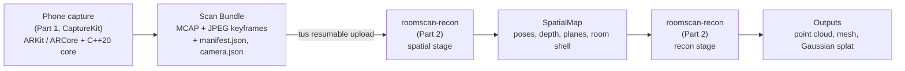

# SCENELY

SCENELY turns a phone into a room surveyor. **Part 1** is a native iOS and Android capture app (CaptureKit) that
watches the room while you scan, judges capture quality continuously, guides you with templated voice
instructions, and produces a validated **Scan Bundle**. **Part 2** (`roomscan-recon`) takes that bundle and
builds the 3D outputs: refined poses, depth, point clouds, meshes, Gaussian Splats and a semantic room model.
Phone camera only, no LiDAR. Tracking comes from ARKit / ARCore; no custom SLAM.

License: [MIT](LICENSE).

## Architecture



The Scan Bundle is the only contract between the two parts:
[spec](2D-3D/capturekit/spec/scanbundle/README.md) (Part 1) and
[backend view](roomscan-recon/docs/SCAN_BUNDLE.md) (Part 2). Frozen conventions (Y-up world, OpenCV camera frame,
`T_world_from_camera`): [conventions](2D-3D/docs/program-spec/conventions.md).

## Repository map

| Path | What it is |
|---|---|
| [`2D-3D/`](2D-3D/README.md) | Part 1: phone capture. Code lives in [`2D-3D/capturekit/`](2D-3D/capturekit/README.md) |
| [`2D-3D/capturekit/core`](2D-3D/capturekit/core/README.md) | C++20 core shared by both phone platforms (geometry, bundle, quality, governor, guidance) |
| [`2D-3D/capturekit/android`](2D-3D/capturekit/android/README.md) | Kotlin + ARCore library and sample app |
| [`2D-3D/capturekit/ios`](2D-3D/capturekit/ios/README.md) | Swift package and sample app |
| [`2D-3D/capturekit/tools`](2D-3D/capturekit/tools/README.md) | Python CLI `ckit`: validate, inspect, replay, benchmark bundles |
| [`2D-3D/capturekit/dev-server`](2D-3D/capturekit/dev-server/README.md) | Local tusd + MinIO upload stack |
| [`2D-3D/capturekit/docs/decisions`](2D-3D/capturekit/docs/decisions/README.md) | Part 1 architecture decision records (ADRs) |
| [`2D-3D/docs/program-spec`](2D-3D/docs/program-spec/README.md) | Program specification: Part 1 and Part 2 |
| [`roomscan-recon/`](roomscan-recon/README.md) | Part 2: spatial understanding and 3D reconstruction |
| [`roomscan-recon/docs`](roomscan-recon/docs/README.md) | Part 2 docs, interfaces, decisions, phase reports |
| [`docs/dev/`](docs/dev/README.md) | Notes on the agent-assisted development workflow and historical session docs |
| [`.github/workflows/`](.github/workflows) | CI for both parts |

## Quickstart

Clone with submodules. Prerequisites per part are listed in the linked READMEs.

### Part 1: CaptureKit
From [`2D-3D/capturekit/README.md`](2D-3D/capturekit/README.md):

```sh
git clone --recurse-submodules <repo-url> && cd 2D-3D/capturekit
./scripts/bootstrap.sh            # submodules, OpenCV prebuilt, reference repos, tools/.venv

# C++ core
cmake -S core -B build/core && cmake --build build/core && ctest --test-dir build/core

# Python tools
tools/.venv/bin/ckit --version

# Android (from android/)
./gradlew assembleDebug testDebugUnitTest

# iOS (from ios/, macOS only)
swift build && swift test

# Upload dev server (from dev-server/)
docker compose up -d && ./smoke_test.sh
```

### Part 2: roomscan-recon
From [`roomscan-recon/CLAUDE.md`](roomscan-recon/CLAUDE.md) and [`roomscan-recon/README.md`](roomscan-recon/README.md), run inside `roomscan-recon/`:

```bash
uv sync --extra cpu
uv run pytest -m light
uv run ruff check
bash data/fetch.sh replica
uv run python -m spatial.cli run --dataset replica --src data/replica/room0 --out runs/sample_run
```

Splat training needs an NVIDIA GPU: [GPU runbook](roomscan-recon/docs/heavy-compute/GPU_RUNBOOK.md).

## Status at a glance

No numbers are repeated here; they go stale. Read the sources, which carry dates and evidence paths:

- Whole program, one row per feature (done / partial / GPU-unverified / Android-only / not built):
  [`roomscan-recon/docs/FEATURE_STATUS.md`](roomscan-recon/docs/FEATURE_STATUS.md)
- Part 1 detail, default feature flags, open device checks: [`2D-3D/docs/STATUS.md`](2D-3D/docs/STATUS.md) and
  [`2D-3D/docs/DEVICE_TEST_LOG.md`](2D-3D/docs/DEVICE_TEST_LOG.md)
- Part 2 phase evidence: [`roomscan-recon/PROGRESS.md`](roomscan-recon/PROGRESS.md) and
  [`roomscan-recon/docs/PHASE_REPORTS/`](roomscan-recon/docs/PHASE_REPORTS)
- Known limits stated by those documents as of 2026-11-22: the iOS app has not been compiled on a Mac, and
  splat training has not been run on an NVIDIA GPU.

## Demo

> **Placeholder: no demo media has been recorded yet.** A screen recording of a guided scan and a rendered
> reconstruction will be added here.

<!-- TODO(demo): replace this block with a video link and screenshots. Do not add claims without media. -->

## Continuous integration

GitHub runs workflows only from the repository root: [`capturekit-ci.yml`](.github/workflows/capturekit-ci.yml)
(Part 1; the macOS job is non-blocking) and [`roomscan-ci.yml`](.github/workflows/roomscan-ci.yml)
(Part 2: charter check, ruff, light tests).

## License

[MIT](LICENSE) (c) 2026 The SCENELY Team. Git submodules under `2D-3D/capturekit/third_party/` (Eigen, MCAP,
nanobind, Sophus) keep their own licences. Datasets used for benchmarks keep theirs, see
[`roomscan-recon/data/DATASETS.md`](roomscan-recon/data/DATASETS.md).
